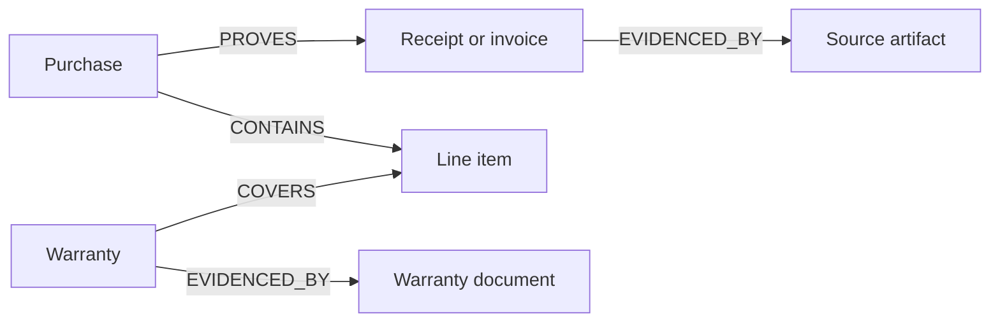

# Report format

The final answer is a Markdown report plus a machine-readable JSON block. Keep the user-facing answer short and put audit detail in the structured sections.

## Required sections

1. **Answer** — one paragraph answering the user's question. State the scope, report date, and the most important warranty or proof finding.
2. **Warranty timeline** — one row per warranty with product, purchase date, term, end date, status, and evidence. Use `unknown` rather than guessing.
3. **Purchases** — one row per purchase with merchant, date, total, currency, order/receipt/invoice references, and linked evidence.
4. **Findings** — gaps, mismatches, ambiguous matches, unlinked warranties, and coverage gaps.
5. **Evidence table** — claim, value, source type, verified reference, location or page, and route state.
6. **Coverage** — every route, including not-run and empty routes.
7. **Graph** — nodes and edges with provenance. A Mermaid view is optional; JSON is authoritative.
8. **Proposed next actions** — suggestions only, each with `requires_confirmation: true` and `executed: false`.
9. **Limitations** — what could not be verified, what was truncated, and what requires a NAS test.

## JSON shape

```json
{
  "answer": "Short grounded answer.",
  "report_meta": {
    "report_date": "YYYY-MM-DD",
    "as_of_date": "YYYY-MM-DD",
    "expiry_window_days": 60,
    "scope_paths": ["verified folder path"],
    "synthetic_example": true
  },
  "warranty_timeline": [
    {
      "product": "Product name",
      "purchase_date": "YYYY-MM-DD",
      "term_text": "24 months from purchase",
      "end_date": "YYYY-MM-DD",
      "status": "active|expiring_soon|expired|unknown",
      "status_rule": "explicit_end_date|stated_term_from_verified_start_date|unknown",
      "evidence_refs": ["verified citation or source reference"]
    }
  ],
  "purchases": [
    {
      "purchase_id": "p1",
      "merchant": "Merchant name",
      "date": "YYYY-MM-DD",
      "total": "0.00",
      "currency": "USD",
      "order_number": "optional",
      "receipt_refs": ["verified source reference"],
      "invoice_refs": ["verified source reference"],
      "line_items": [
        {
          "description": "Line description",
          "product": "Product name",
          "model": "optional",
          "serial": "optional",
          "quantity": "optional",
          "amount": "optional"
        }
      ]
    }
  ],
  "findings": [
    {
      "finding_id": "f1",
      "finding_type": "expiring_soon|expired|missing_purchase_proof|mismatch|ambiguous_match|possible_match|unlinked_warranty|coverage_gap",
      "summary": "What was found.",
      "evidence_refs": ["verified reference"],
      "severity": "info|warning|action_needed"
    }
  ],
  "evidence": [
    {
      "claim": "Short claim",
      "value": "Verified value",
      "source_type": "expert_result|parent_inference",
      "agent": "file-agent|document-agent|photo-agent|parent",
      "source_ref": "verified reference",
      "location": "page, segment, or OCR reference",
      "route_state": "completed|failed|cancelled|waiting_user|waiting_approval|not_run"
    }
  ],
  "coverage": [
    {
      "route": "file-agent",
      "state": "completed|failed|cancelled|waiting_user|waiting_approval|not_run",
      "items": 0,
      "failures": [],
      "truncated": false
    }
  ],
  "graph": {
    "nodes": [
      {
        "id": "n1",
        "type": "Purchase",
        "props": {},
        "provenance": {}
      }
    ],
    "edges": [
      {
        "id": "e1",
        "type": "PROVES",
        "from": "n1",
        "to": "n2",
        "status": "asserted|inferred|ambiguous",
        "rule": "optional rule",
        "provenance": {}
      }
    ]
  },
  "proposed_next_actions": [
    {
      "action": "Suggested follow-up",
      "requires_confirmation": true,
      "executed": false
    }
  ],
  "limitations": ["What could not be verified or still needs a NAS test."]
}
```

## Presentation rules

- Put the strongest finding first in the answer, but never stronger than the evidence.
- Show `unknown` status explicitly. Do not hide it in a footnote.
- Show `expired` only when an end date is verified or the stated-term computation is labeled.
- Show mismatches as findings, not as silent corrections.
- Keep synthetic examples labeled `synthetic_example: true`.
- If the report is partial, put the partial label in the answer and repeat affected routes in `coverage`.
- Do not include a graph edge that has no provenance.

## Mermaid view (optional)


